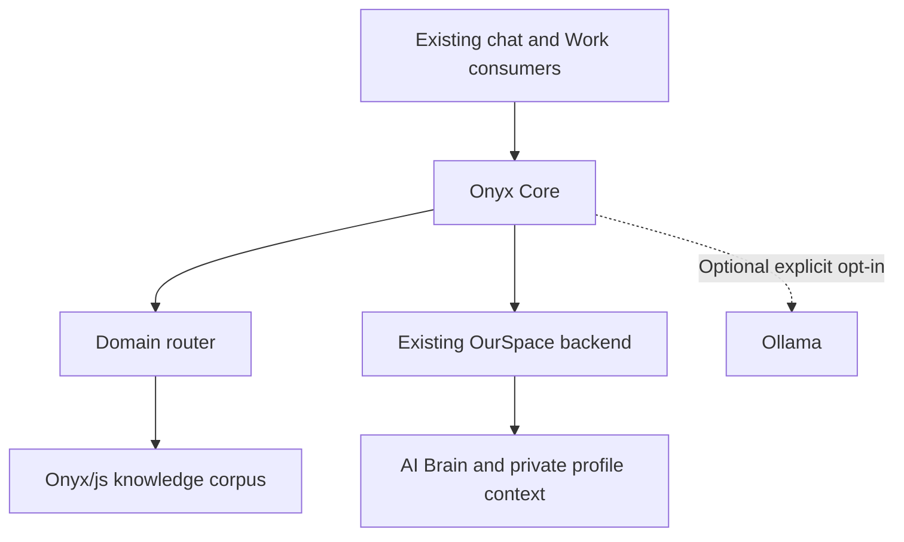

# Onyx AI brain integration

## Purpose

`Onyx/` is exclusively Onyx's **brain and knowledge store**, not a game, widget, or graphical interface. Keep Happy Home, Feed Him MEOW, sprite sheets, renderers, virtual-pet state, and widgets outside this directory. Other applications may consume the brain API without copying presentation code into it.

Onyx is an LLM-powered agent/persona. His frontend runtime supplies personality continuity, retrieval, memory context, tools, and routing; responses are generated by the configured AI Brain or an explicitly enabled Ollama model. No LLM weights or replacement backend are bundled.

## File placement

| Responsibility | Location |
|---|---|
| Conversation and Work brain API | `Onyx/script/js/onyx/onyx-core/` |
| Knowledge corpus and domain skills | `Onyx/js/` |
| Search index and personality/runtime contracts | `Onyx/json/shared/onyx-core/` |
| Documentation and brain tests | `Onyx/docs/` |

The existing OurSpace Apps Script deployment remains the only remote backend. No server implementation was copied into frontend folders.

## How the brain works



The generated file index covers the **8,430 existing files** in `Onyx/js/`. The router loads bounded excerpts on demand rather than the entire multi-gigabyte corpus. Those corpus files and existing import paths remain unchanged.

## Core API

```js
import OnyxCore from "./Onyx/script/js/onyx/onyx-core/index.js";
const result = await OnyxCore.chat({
  message: "Help me revise this chapter",
  surface: "core",
  history: []
});
console.log(result.response);
console.log(result.llmVerified); // true or an exception is thrown
```

The brain has one core surface. Legacy `surface: "virtual"` / `lane: "virtual"` inputs normalize to `core`, destination `onyx-core`. A consumer's visual state belongs to that consumer, not to this repository.

## Security and verification

- `onyx.health` must report `aiBrain.configured === true` for readiness.
- AI Brain completions require `aiBrain === true` and nonempty output.
- The backend must prove the authenticated profile and `personalityFiltered === true`; mismatches throw `ProfileVerificationError`.
- Ollama must prove its configured model exists in `/api/tags` and return nonempty model-labeled output from `/api/chat`.
- Missing model proof throws `LLMVerificationError`. Templates, cached text, and retrieval results cannot impersonate model output.
- `Onyx/js/chatbot.js` remains a dormant read-only corpus-inspection helper, not an answer provider.
- Authentication uses the in-memory OurSpace backend bridge or an already-issued token via `setAuthContext`. Tokens and secrets are never embedded into public code.
- The full personality dossier and relationship-address rules stay private and backend-authoritative. The repository includes only safe public continuity contracts and fingerprints.
- Master dossier fingerprint: `c19441d70441e3c5273b2a8a3750df6c563582a80378c67e4a8017eda35260ac`.
- Finch addendum fingerprint: `74a54188ce1676da9c263825fcba095f3787ad4a24c22bd60dfb61e0f265ff1a`.
- The active authenticated profile controls relationship language. A message cannot impersonate the other profile.
- Ollama receives no private backend dossier and labels local results `profileVerified: false`.

## Capabilities and limits

The brain understands chat, writing, coding, research, images, file handling, project help, and game-design **knowledge**. It does not contain a game. Requests with write effects remain subject to explicit user intent and guarded tools. Virtual-pet actions, game rooms, sprite loading, and widget rendering are intentionally absent.

The optional Ollama provider is disabled by default and loopback-only unless explicitly configured otherwise. The bounded agent follows a plan → execute → verify loop with step limits and write protection; no AutoGPT Platform source was copied into Onyx.

## Validation

From the repository root, run:

```sh
node Onyx/script/js/onyx/onyx-core/self-test.mjs
```

This validates corpus coverage, domain routing, core-only requests, listen-only behavior, backend calls, profile isolation, LLM proofs, write guards, and Ollama restrictions. See `ONYX_BRAIN_TEST_PLAN.md`.


## Profile-scoped conversation memory and learning

Onyx has one memory policy shared by every OurSpace lane. The core uses the existing `onyx.chat.history` action only when the authenticated session identifies William or Jasper. A history response is accepted only when the backend marks it account-scoped and returns the same active profile key. Cross-profile history is discarded.

The memory module filters recalled user messages for obvious medical, crisis, and private-contact details, ranks relevant entries against the current request, and bounds the context sent to Gemini. Its short-lived cache stays in JavaScript memory and is cleared when the active profile changes or authentication is cleared. It does not use localStorage, IndexedDB, or browser cookies for memory.

Learning means using direct preferences and corrections from the current user's messages to guide later replies. Past messages are treated as historical data, never as instructions or permission to perform a write. Durable memory still goes through the existing backend's `autoRemember` handling. An explicit no-memory request and serious/crisis turns disable it. No model training or weights are added.

The widget bridge carries its existing memory choice to the core, so health, virtual, leisure, work, professor, and game conversations continue through one authenticated Gemini brain. The machine-readable policy and review of all supplied Drive repository resources are recorded in `json/shared/onyx-core/donor-architecture-map.json`. That map records design patterns only; no source archives, Python implementations, or model weights are copied into Onyx.
