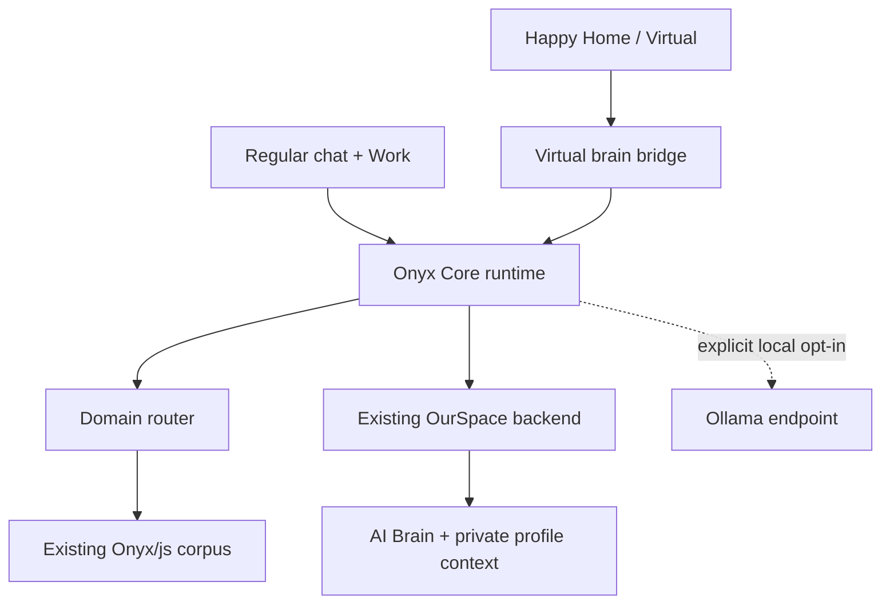

# Onyx unified AI brain integration

## Result

Onyx now has one frontend brain runtime for ordinary conversation and Work tasks—writing, coding, research, files, projects, and ideas—and one narrow adapter that lets Happy Home / Virtual use that same brain. The existing OurSpace Apps Script deployment remains the only remote backend. No replacement backend was created or copied into a frontend directory.

Onyx is an LLM-powered agent/persona, not a new set of model weights embedded in JavaScript. The language model runs through the existing configured AI Brain (or an explicitly enabled Ollama model); the frontend supplies Onyx's identity, retrieval, memory context, tools, and mode routing.

## File placement

| Responsibility | Location |
|---|---|
| Shared chat + Work runtime | `Onyx/script/js/onyx/onyx-core/` |
| Happy Home / Virtual adapter | `Onyx/script/js/onyx/games/virtual/` |
| Shared routing manifests | `Onyx/json/shared/onyx-core/` |
| Browser integration harness | `Onyx/assets/code/happy-home.html` |
| Shared styles | `Onyx/style/css/onyx/onyx-core/` |
| Virtual-only styles | `Onyx/style/css/onyx/games/virtual/` |

There is deliberately no backend source under `script`, `style`, `assets`, or any other frontend folder.

## LLM proof and fail-closed behavior

The runtime does not trust a successful HTTP response by itself:

- connection readiness requires the live `onyx.health` response to report `aiBrain.configured === true`;
- every AI Brain completion must contain `aiBrain === true` and non-empty model output;
- every backend completion must name the same authenticated profile expected by the client and report `personalityFiltered === true`;
- every Ollama connection must prove that the configured model appears in `/api/tags`;
- every Ollama completion must come from `/api/chat` with a named model and non-empty output;
- missing proof throws `LLMVerificationError`; the text is not displayed as an Onyx answer;
- missing or conflicting profile proof throws `ProfileVerificationError`; the text is not displayed as an Onyx answer;
- retrieval, routing, templates, and canned strings can provide context or report an error, but cannot impersonate a successful model completion.

The older `Onyx/js/chatbot.js` is a dormant read-only corpus inspection helper. It is not imported by the unified runtime and is not accepted as an Onyx response provider.

## How the pieces connect



The domain registry exposes the existing Onyx corpus to the runtime by subject. A generated file index covers all 8,430 files (2,788,004,826 bytes) currently under `Onyx/js/`. For each turn the router selects relevant domain guides and a small set of matching source files, loads only bounded text excerpts, and supplies them to the AI Brain as references. This gives Onyx on-demand access to every indexed part without trying to load 2.8 GB into every page. Existing files stay where they are, so their current imports and live pages are not broken.

## Main API

```js
import OnyxCore from "./script/js/onyx/onyx-core/index.js";

const result = await OnyxCore.chat({
  message: "Help me revise this chapter",
  surface: "core",
  history: []
});

console.log(result.response);
console.log(result.llmVerified); // true, or chat() throws
```

Virtual uses the same singleton runtime:

```js
import OnyxVirtualBrain from "./script/js/onyx/games/virtual/virtual-brain-bridge.js";

OnyxVirtualBrain.observe("virtual.room.enter", { room: "base-room" });
const result = await OnyxVirtualBrain.talk("What should we do next?", {
  room: "base-room",
  petState: { mood: "curious" }
});
```

## Authentication and privacy

- When embedded in OurSpace, the runtime reuses the existing in-memory `OurSpaceBackend` bridge.
- A standalone page may receive an already-issued session token through `setAuthContext`; the runtime keeps it only in memory.
- It never searches local storage, logs a token, embeds a client secret, or asks the user to type backend credentials into the Happy Home harness.
- The complete personality dossier and profile-specific address rules stay private and backend-authoritative. The public repository contains only a safe continuity contract and the dossier fingerprint used to detect version drift.
- The master dossier fingerprint is `c19441d70441e3c5273b2a8a3750df6c563582a80378c67e4a8017eda35260ac`; the Finch addendum fingerprint is `74a54188ce1676da9c263825fcba095f3787ad4a24c22bd60dfb61e0f265ff1a`.
- The runtime pins relationship handling to the authenticated profile. A message cannot switch profiles by naming a person or requesting the other relationship style.
- The backend remains responsible for selecting the profile-specific relationship model, injecting only that profile's private dossier context, and sanitizing relationship language. The frontend rejects the reply unless the backend confirms that filtering occurred.
- The optional Ollama adapter receives only the message, selected public guide material, and references the user deliberately supplies to that local turn. It does not receive private backend profile context.
- Because Ollama does not receive either private profile dossier, its replies are explicitly marked `profileVerified: false` and remain relationship-neutral.

## Capability routing

`createCapabilityPlan()` identifies chat, writing, coding, ideas, research, file, image, project, and game intents. It then chooses relevant brain domains and sends one bounded request to the existing backend with the backend's supported controls:

- web search and URL reading for current or explicit research;
- Drive/file context when the request needs it;
- image generation and file/archive tools only for an explicit creation request;
- no coaching tools when the user says to just listen;
- safe auto-memory disabled for sensitive turns;
- a shared profile-scoped conversation thread across Core and Virtual.

## Ollama and AutoGPT merge boundaries

The Ollama contribution is an optional provider adapter, disabled by default and restricted to loopback unless the caller deliberately permits a remote host. The browser does not embed or pretend to compile Ollama's native server.

The AutoGPT contribution is architectural: a bounded plan → execute → verify loop, step limit, repeated-step guard, and explicit write guard. The restricted AutoGPT Platform was not vendored. No third-party source file was copied into this frontend.

## Validation

From the repository root:

```sh
node Onyx/script/js/onyx/onyx-core/self-test.mjs
```

The test validates all-file corpus coverage, domain coverage, Core versus Virtual routing, listen-only behavior, backend chat wiring, separate William/Jasper profile binding, caller-override resistance, profile-mismatch rejection, personality-filter proof, shared thread continuity, model-proof enforcement, rejection of canned/unverified output, write guards, and the Ollama loopback restriction.

